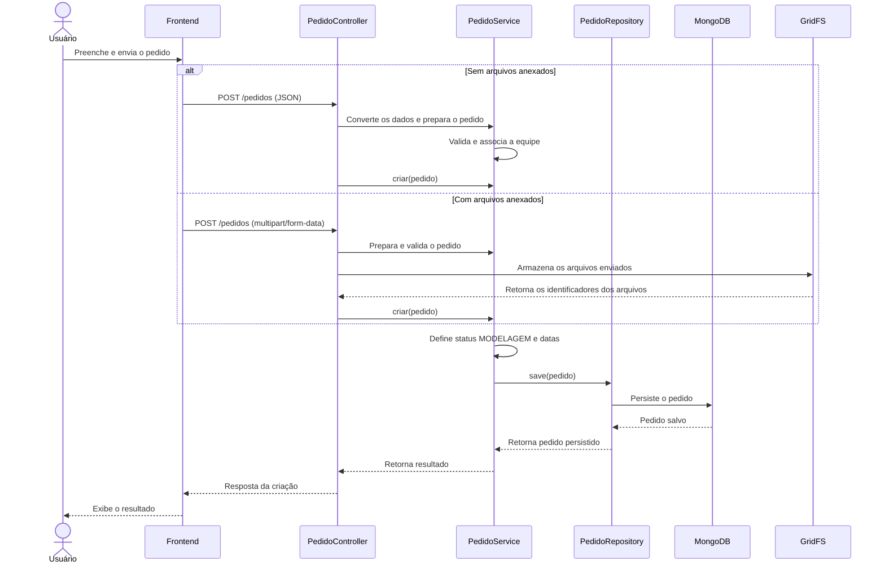
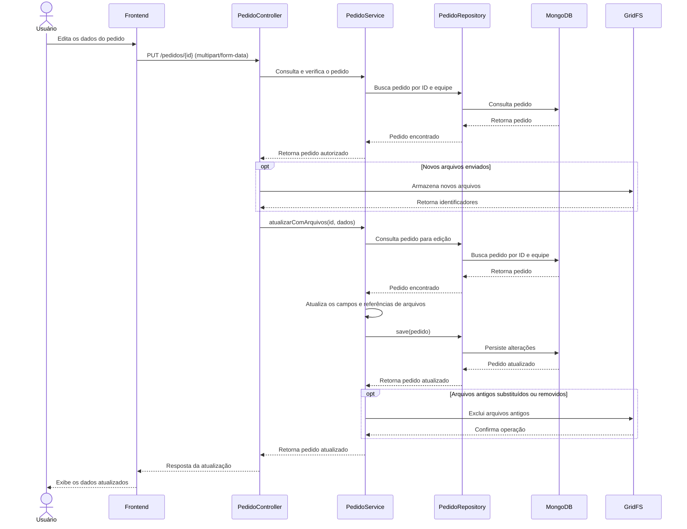

# 🚀 Synapse Forge - Backend
## 🧠 Arquitetura

O projeto foi estruturado utilizando uma arquitetura em camadas, seguindo boas práticas de desenvolvimento:

- **Controller** → Responsável por expor os endpoints da API  
- **Service** → Contém as regras de negócio  
- **Repository** → Responsável pelo acesso ao banco de dados  
- **DTO (Data Transfer Object)** → Controla os dados de entrada e saída  
- **Entity** → Representa os dados persistidos  

Essa separação garante melhor organização, manutenção e escalabilidade do sistema.

---

## ⚙️ Tecnologias Utilizadas

- Java 17  
- Spring Boot  
- MongoDB  
- Spring Data MongoDB  
- Lombok  
- Bean Validation  
- Maven  

---

## 🗄️ Banco de Dados

O sistema utiliza o MongoDB, um banco de dados NoSQL orientado a documentos.

### Configuração:

```properties
spring.data.mongodb.uri=mongodb://localhost:27017/synapse-forge
server.port=8081
```
---

## 👤 Funcionalidade Implementada
### CRUD de Usuários

O sistema atualmente possui um CRUD completo de usuários, permitindo:

- Criar usuários
- Listar usuários
- Buscar usuário por ID
- Atualizar usuário
- Deletar usuário
- Inserir múltiplos usuários (batch)

---

## 📄 Estrutura do Usuário
A entidade de usuário contém os seguintes campos:

- id → Identificador único
- nome → Nome do usuário
- email → Email do usuário
- senha → Senha do usuário
- role → Tipo de usuário

---

## 🔐 Tipos de Usuário (Role)
- ADMIN → Administrador
- GERENTE → Gerente
- TECNICO → Funcionário técnico
- CLIENTE → Cliente

---

## 🔄 DTO (Data Transfer Object)

Foram implementados DTOs para separar a entrada e saída de dados:

- UserRequestDTO → Dados recebidos pela API
- UserResponseDTO → Dados retornados pela API

⚠️ A senha do usuário não é retornada nas respostas, garantindo maior segurança.

---

## ✅ Validação de Dados

O sistema utiliza Bean Validation para garantir integridade dos dados:

- @NotBlank → Campos obrigatórios
- @Email → Validação de formato de email

Caso os dados sejam inválidos, a API retorna erro automaticamente.

---

## 🌐 Endpoints da API

- BASE URL: http://localhost:8081/users

- Criação de Usuário (POST)
- Criação em Lote de Usuário (POST)
- Buscar (GET)
- Buscar por Id (GET)
- Atualizar Usuário (PUT)
- Remover usuário (DELETE)


## Modelagem do Sistema

Esta seção apresenta os diagramas utilizados para representar as funcionalidades do Synapse Forge e o funcionamento dos principais fluxos do sistema. A modelagem auxilia na compreensão das interações entre os usuários e a aplicação, além de demonstrar a comunicação entre as camadas do sistema durante a execução das operações.

### 1. Diagrama de Casos de Uso

O diagrama de casos de uso apresenta as principais funcionalidades do Synapse Forge e os atores que interagem com o sistema. Seu objetivo é representar, de forma visual, as operações disponíveis para cada perfil de usuário e os relacionamentos entre os atores e as funcionalidades.

Os atores considerados na modelagem são Administrador, Gerente, Técnico e Cliente. Cada perfil possui responsabilidades e permissões específicas, de acordo com as funções desempenhadas no sistema.

Entre as funcionalidades representadas estão o gerenciamento de usuários, pedidos, equipe, cores, materiais e comentários, além da consulta de informações e do gerenciamento do perfil. A autenticação permite o acesso às funcionalidades restritas conforme as permissões de cada usuário.

**Diagrama de casos de uso:**


### 2. Diagrama de Sequência — Criação de Pedido

O diagrama de sequência de criação de pedido representa a comunicação entre o usuário, o frontend, o backend e os mecanismos de persistência durante o cadastro de um novo pedido no Synapse Forge.

O fluxo começa quando o usuário preenche as informações do pedido e solicita seu cadastro pela interface. O frontend envia os dados ao backend, que recebe a requisição por meio do `PedidoController` e encaminha o processamento para o `PedidoService`.

A aplicação permite o envio dos dados em JSON quando não há arquivos anexados ou em `multipart/form-data` quando o pedido inclui arquivos. Nesse segundo cenário, os arquivos de referência e o modelo 3D são armazenados no GridFS, conforme os dados enviados.

Antes da persistência, o sistema prepara o pedido, verifica as informações necessárias e associa o pedido à equipe correspondente. Em seguida, define o status inicial como `MODELAGEM`, registra as datas pertinentes e salva o pedido no MongoDB por meio do repositório.

Ao final do processamento, o backend retorna a resposta da operação ao frontend, que pode apresentar o resultado ao usuário.

**Diagrama de sequência:**



### 3. Diagrama de Sequência — Edição de Pedido

O diagrama de sequência de edição de pedido representa o fluxo de atualização de um pedido existente, incluindo a alteração de informações e, quando necessário, a substituição ou remoção de arquivos associados ao projeto.

O processo começa quando o usuário solicita a edição pela interface. O frontend envia uma requisição `PUT` para o backend utilizando `multipart/form-data`, permitindo transmitir os dados atualizados e eventuais arquivos novos.

O `PedidoController` recebe a requisição e aciona os serviços responsáveis pela consulta e atualização do pedido. O backend verifica se o pedido pode ser editado pelo usuário, considerando as regras de acesso e o vínculo com a equipe. Em seguida, atualiza os campos enviados e valida as informações pertinentes.

Quando novos arquivos são enviados, eles são armazenados no GridFS, e suas referências são associadas ao pedido. Caso arquivos antigos tenham sido substituídos ou removidos, o sistema realiza a exclusão correspondente após salvar as alterações do pedido.

Por fim, o pedido atualizado é persistido no MongoDB, e o backend retorna a resposta ao frontend para que a interface apresente os dados atualizados.

**Diagrama de sequência:**



### 4. Considerações sobre a Modelagem

Os diagramas apresentados complementam a documentação dos requisitos do Synapse Forge. O diagrama de casos de uso oferece uma visão geral das funcionalidades e dos perfis que interagem com o sistema, enquanto os diagramas de sequência detalham a comunicação entre os componentes durante a criação e a edição de pedidos.

A utilização desses modelos facilita a compreensão dos fluxos de negócio, contribui para a organização da arquitetura da aplicação e auxilia na análise da implementação. Os diagramas devem ser mantidos alinhados ao código-fonte à medida que novas funcionalidades ou alterações forem realizadas.
