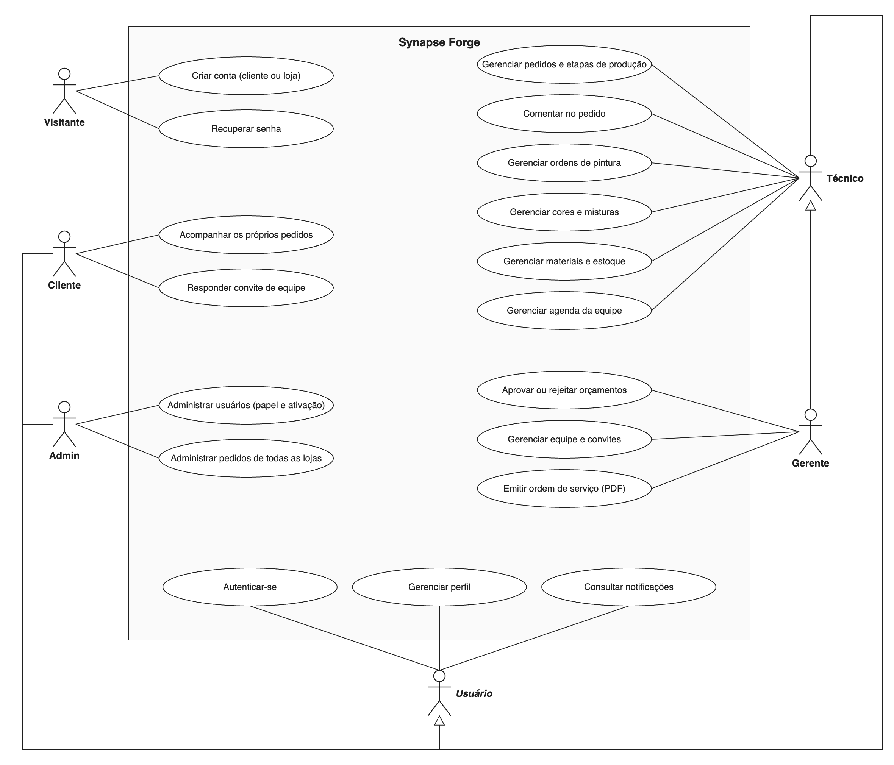
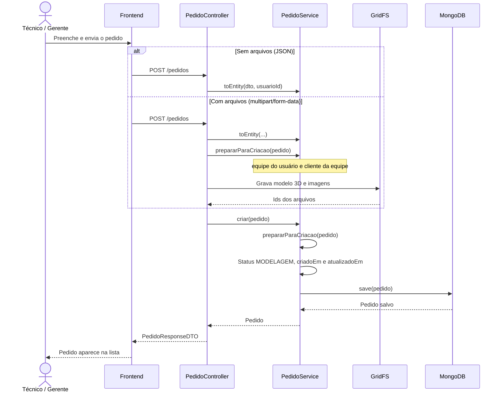
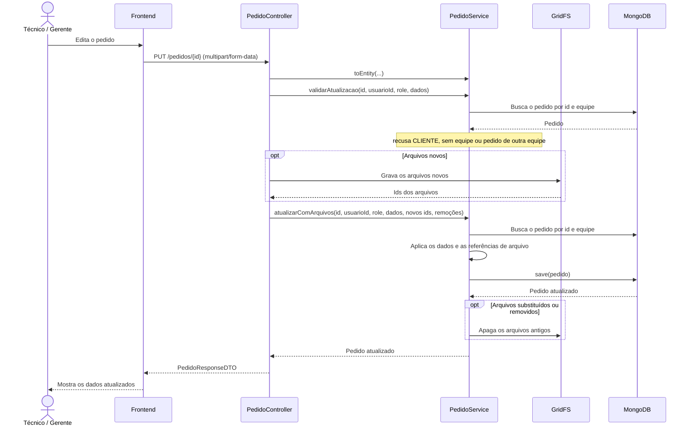

# 🚀 Synapse Forge - Backend

## 🧠 Arquitetura

O projeto foi estruturado em camadas para manter a aplicação organizada e escalável:

- **Controller** → expõe os endpoints da API
- **Service** → concentra a lógica de negócio
- **Repository** → acessa os dados no MongoDB
- **DTO** → define entradas e saídas da aplicação
- **Entity** → representa os documentos persistidos
- **Config** → centraliza segurança, CORS, inicialização e documentação

Essa estrutura facilita manutenção, testes e evolução do sistema.

---

## ⚙️ Tecnologias Utilizadas

- Java 17
- Spring Boot 3
- Spring Security
- JWT
- MongoDB
- Spring Data MongoDB
- Bean Validation
- OpenAPI / Swagger
- Lombok
- Maven

---

## 🗄️ Banco de Dados e Configuração

O sistema utiliza MongoDB como banco principal.

### Configuração padrão

```properties
spring.data.mongodb.uri=mongodb://localhost:27017/synapse-forge
server.port=8081
spring.application.name=synapse-forge-db
```

Também há suporte para upload de arquivos, email e CORS configurados por variáveis de ambiente.

### Credenciais locais

Credenciais ficam em `src/main/resources/application-secrets.properties` (ignorado pelo git). Copie o modelo e preencha:

```bash
cp src/main/resources/application-secrets.properties.example src/main/resources/application-secrets.properties
```

O segredo do JWT é obrigatório: sem ele a aplicação não sobe. Gere um valor e coloque em `app.jwt.secret` nesse arquivo (ou na variável `APP_JWT_SECRET`):

```bash
openssl rand -base64 32
```

### Variáveis de ambiente

| Variável | Padrão | Uso |
|---|---|---|
| `APP_JWT_SECRET` | nenhum (obrigatória) | Segredo de assinatura dos tokens, em Base64 com pelo menos 32 bytes. Trocar o valor desloga todo mundo |
| `APP_URL` | `http://localhost:5173` | URL do front usada nos links de email |
| `APP_CORS_ALLOWED_ORIGINS` | `http://localhost:5173,http://127.0.0.1:5173` | Origens liberadas no CORS |
| `APP_ADMIN_EMAILS` | vazio | Emails autorizados a usar `/admin/**` |
| `APP_SWAGGER_ENABLED` | `true` | Liga/desliga o Swagger UI e o `/v3/api-docs` |
| `APP_SEED_ENABLED` | `true` | Liga/desliga a criação dos dados de teste |
| `APP_SEED_DASHBOARD_MOCKS` | `true` | Liga/desliga só os pedidos e materiais fictícios do dashboard (exige `APP_SEED_ENABLED`) |
| `APP_MONGO_SCHEMA_VALIDATION_ENABLED` | `true` | Aplica o `$jsonSchema` nas coleções na subida |
| `APP_MONGO_SCHEMA_VALIDATION_ACTION` | `error` | `error` recusa documento inválido; `warn` só registra no log do MongoDB |

> Em produção, use `APP_SWAGGER_ENABLED=false` e `APP_SEED_ENABLED=false`. O usuário do MongoDB precisa do privilégio `collMod` para aplicar o JSON Schema em coleções que já existem (o papel `readWrite` não tem); sem ele a aplicação sobe e só registra um aviso.

---

## ▶️ Como rodar

Pré-requisitos: Java 17 e um MongoDB rodando em `localhost:27017`.

```bash
./mvnw spring-boot:run   # sobe a API em http://localhost:8081
./mvnw verify            # build + testes
```

---

## 🔐 Segurança e Autenticação

O backend possui autenticação baseada em JWT e controle de acesso por perfil de usuário.

### Roles disponíveis

- **ADMIN** → administração geral (as rotas `/admin/**` exigem, além do papel, que o email esteja em `APP_ADMIN_EMAILS`)
- **GERENTE** → gestão de equipe e operações da loja
- **TECNICO** → operação técnica e produção
- **CLIENTE** → acesso ao cliente

### Recursos de segurança

- autenticação via login, com token JWT de 1 hora assinado com `APP_JWT_SECRET`
- papel e situação do usuário lidos do cadastro a cada requisição: conta apagada, desativada ou rebaixada perde o acesso na hora
- confirmação de email
- recuperação e redefinição de senha
- bloqueio de 15 minutos na conta depois de 5 senhas erradas
- limite de tentativas por IP em login, cadastros e recuperação de senha (429 com `Retry-After`)
- controle de acesso por rota e permissão
- arquivos enviados só são servidos com tipos de uma lista fixa (imagens, modelos 3D e PDF)

---

## 📚 Swagger / OpenAPI

O projeto agora inclui documentação interativa da API com Swagger UI.

### Acesso

- Swagger UI: http://localhost:8081/swagger-ui/index.html
- JSON da API: http://localhost:8081/v3/api-docs

O Swagger também foi configurado para aceitar autenticação JWT via bearer token, permitindo testar endpoints protegidos diretamente pela interface: faça `POST /auth/login`, copie o `access_token` e cole em **Authorize**.

As rotas do Swagger são públicas. Para não expor o mapa da API em produção, desligue com `APP_SWAGGER_ENABLED=false`.

---

## 👤 Funcionalidades do Sistema

### 1) Usuários

O sistema conta com CRUD completo de usuários, incluindo:

- criar usuário
- listar usuários
- buscar por ID
- atualizar dados
- excluir usuário
- cadastro em lote
- alteração de perfil próprio
- confirmação de email
- reset de senha
- gerenciamento de email pendente para troca
- preferências salvas do próprio usuário: tema, idioma e dashboard (período e widgets na ordem escolhida)

### 2) Autenticação e conta

- cadastro de usuários
- login com JWT
- confirmação de acesso por email
- recuperação de senha
- redefinição de senha
- validação de email e senha

### 3) Equipes e gestão operacional

- criação e administração de equipes
- vínculo de usuários a equipes
- convites de equipe
- controle de gerente e membros da equipe

### 4) Pedidos e produção

- criação e gerenciamento de pedidos
- acompanhamento de consumo por pedido
- orçamentos
- misturas
- ordens de pintura
- controle de estoque
- métricas de produção
- eventos e movimentações relacionadas ao processo

### 5) Materiais / Cores / Estoque

- cadastro de materiais
- cadastro de cores
- controle de acabamentos
- gestão de estoque
- ajustes e consumo por pedido

---

## 🧪 Dados de Teste Inseridos automaticamente

Ao iniciar a aplicação, o sistema cria automaticamente usuários e dados fictícios para facilitar testes de desenvolvimento e demonstração. Isso pode ser desligado com `APP_SEED_ENABLED=false` (obrigatório em produção, já que todos usam a mesma senha).

Esses dados foram inseridos para simular cenários reais do sistema, sem depender de um ambiente externo.

### Usuários de teste criados

#### Clientes falsos

- **Alice Silva** — `alice.silva@teste.com`  
  Papel: `CLIENTE`  
  Uso: simula um cliente comum para testar login, visualização de pedidos e fluxo do cliente.

- **Antonio Santos** — `antonio.santos@teste.com`  
  Papel: `CLIENTE`  
  Uso: representa outro cliente de exemplo para validar listagens, filtros e operações que envolvem clientes distintos.

#### Funcionários de teste

- **Funcionario Teste** — `funcionario@teste.com`  
  Papel: `TECNICO`  
  Uso: representa um colaborador técnico para testar manutenção de estoque, produção, pedidos e associação à equipe.

- **Funcionario Teste 2** — `funcionario2@teste.com`  
  Papel: `TECNICO`  
  Uso: simula outro técnico na mesma equipe para testar fluxo de trabalho em equipe e permissões de acesso.

- **Funcionario Teste 3** — `funcionario3@teste.com`  
  Papel: `TECNICO`  
  Uso: serve como terceiro colaborador para validar divisão de tarefas, equipe e relatórios operacionais.

#### Gerente de teste

- **Gerente Teste** — `gerente@teste.com`  
  Papel: `GERENTE`  
  Uso: representa o gestor da equipe, com acesso às operações administrativas e controle da equipe de teste.

### Equipe de teste

O sistema cria uma equipe chamada **Equipe Teste** e associa os usuários técnicos e gerente a ela. Isso ajuda a validar:

- autenticação por perfil
- associação de usuários à equipe
- permissões de gerente e técnicos
- operações que dependem de equipe

### Cores de teste

Também são criadas cores de exemplo como:

- Vermelho Queimado
- Azul Cobalto
- Verde Oliva
- Bege Areia
- Preto Fosco
- Branco Gelo
- Terracota
- Amarelo Mostarda

Essas paletas simulam dados reais usados em orçamentos, misturas e pedidos de pintura.

### Pedidos e materiais do dashboard

Para o dashboard de pedidos (`/pedidos/metricas/por-status` e `/pedidos/metricas/materiais-mais-usados`) ter o que mostrar, a equipe de teste recebe 6 materiais (PLA, PETG, resina, ABS e TPU) e 24 pedidos espalhados pelos últimos 90 dias, em todos os status, com preços calculados como no orçamento e alguns prazos vencidos. A carga usa ids fixos, então reiniciar a aplicação não duplica nada. Desligue só essa parte com `APP_SEED_DASHBOARD_MOCKS=false`.

---

## 🔑 Credenciais de Acesso de Teste

Todos os usuários de teste usam a mesma senha padrão:

```text
1234
```

Exemplo:

- cliente: `alice.silva@teste.com` / `1234`
- gerente: `gerente@teste.com` / `1234`
- técnico: `funcionario@teste.com` / `1234`

> Esses usuários existem para facilitar testes de desenvolvimento e validação do front-end/backend em ambiente local. Eles são criados sempre que `APP_SEED_ENABLED` não for `false`.

---

## ✅ Validação de Dados

O sistema utiliza Bean Validation para garantir integridade das entradas:

- `@NotBlank` → campos obrigatórios
- `@Email` → validação de formato do email
- regras de negócio adicionais em services

Caso os dados sejam inválidos, a API retorna erro automaticamente.

---

## 🌐 Endpoints principais

A lista completa, com parâmetros e modelos de requisição/resposta, está no Swagger UI (`/swagger-ui/index.html`), que é gerado a partir do código e fica sempre atualizado. Visão geral por recurso:

| Base | O que faz |
|---|---|
| `/auth` | cadastro (cliente e gerente), login, confirmação de email, esqueci/redefinir senha |
| `/users` | CRUD de usuários, lote, perfil próprio (`/me`), preferências (`/me/preferencias`), busca de clientes, troca de email |
| `/equipes` | criar/editar/excluir equipe, `/minha`, integrantes, convites, foto e banner |
| `/pedidos` | CRUD de pedidos, avanço/regressão de status, cancelamento, objeto 3D e ordem de serviço |
| `/orcamentos` | cálculo, criação (com arquivos), aprovação/rejeição, objeto 3D e imagens |
| `/consumos-pedido` | registro e consulta do consumo de insumos por pedido |
| `/estoque` | entrada, ajuste, saldo, movimentos e alertas de estoque |
| `/estoque/metricas` | consumo por insumo/etapa, custo por pedido, média semanal, insumos críticos |
| `/materiais` | CRUD de materiais |
| `/cores` | CRUD de cores |
| `/misturas` | CRUD de misturas |
| `/ordens-pintura` | CRUD de ordens de pintura e avanço de etapa |
| `/evento` | CRUD de eventos da agenda e busca por mês |
| `/admin` | gestão de usuários e pedidos (restrito a administradores autorizados) |

---

## 🧩 Modelagem do Sistema

Esta seção apresenta os diagramas que representam as funcionalidades do Synapse Forge e os principais fluxos do sistema. A modelagem ajuda a entender as interações entre os usuários e a aplicação e a comunicação entre as camadas durante as operações.

### 1. Diagrama de Casos de Uso

O diagrama apresenta as funcionalidades do Synapse Forge e os atores que interagem com o sistema, de acordo com as permissões de cada perfil no back-end.

- **Visitante**: quem ainda não entrou. Cria a conta (como cliente, ou como gerente junto com a loja) e recupera a senha.
- **Usuário** (ator abstrato): o que todo usuário autenticado faz, isto é, entrar, gerenciar o perfil e consultar as notificações do sino.
- **Cliente**: acompanha os próprios pedidos (de qualquer loja) e responde convites para entrar numa equipe.
- **Técnico**: trabalha nos dados da própria equipe, como pedidos e etapas de produção, comentários, ordens de pintura, cores e misturas, materiais e estoque e agenda.
- **Gerente**: é um técnico com mais permissões (generalização Gerente → Técnico). Aprova ou rejeita orçamentos, gerencia a equipe e os convites e emite a ordem de serviço em PDF.
- **Admin**: painel de administração, com usuários (papel e ativação) e pedidos de todas as lojas.

Cliente, Técnico e Admin são especializações de Usuário. O Gerente também é, por herdar do Técnico.



A fonte editável está em [`docs/synapse-forge-casos-de-uso.drawio`](docs/synapse-forge-casos-de-uso.drawio) (abre no [draw.io](https://app.diagrams.net)).

### 2. Diagrama de Sequência: Criação de Pedido

Só técnico, gerente e admin criam pedidos. O pedido pode chegar em JSON, quando não há arquivos, ou em `multipart/form-data`, com o modelo 3D e as imagens de referência.

No caminho multipart, o controller valida o pedido **antes** de gravar os arquivos no GridFS (`prepararParaCriacao`), para que uma requisição recusada não deixe arquivo órfão. Em seguida, `criar` repete a validação: resolve a equipe do usuário logado (403 `SEM_EQUIPE` se ele não tiver equipe) e confere se o cliente informado é da equipe. Depois define o status inicial `MODELAGEM` e as datas e salva o pedido no MongoDB.



### 3. Diagrama de Sequência: Edição de Pedido

A edição existe em JSON (`PUT /pedidos/{id}`) e em `multipart/form-data`, quando há arquivo novo ou removido. O diagrama mostra o caminho multipart.

Antes de gravar qualquer arquivo, `validarAtualizacao` busca o pedido para edição. Cliente não edita, o usuário precisa ter equipe e o pedido precisa ser da equipe dele. A mesma validação confere o cliente informado. Depois disso, os arquivos novos vão para o GridFS e `atualizarComArquivos` aplica os dados recebidos ao pedido (os campos são substituídos pelo que chegou, inclusive vazios) e salva. Os arquivos antigos que foram substituídos ou removidos só são apagados do GridFS depois que o pedido é salvo.

A etapa de produção não muda por aqui: ela tem endpoints próprios (`/status`, `/status/regredir` e `/cancelar`).



### 4. Considerações sobre a Modelagem

O diagrama de casos de uso dá a visão geral das funcionalidades e dos perfis, e os diagramas de sequência detalham a comunicação entre os componentes na criação e na edição de pedidos. Os diagramas precisam acompanhar o código: quando uma permissão ou um fluxo mudar, atualize o `.drawio` (e exporte o PNG em tema claro) e os diagramas desta seção.

---

## 📝 Observações Finais

Este backend foi pensado para funcionar em ambiente de desenvolvimento local, com dados de teste já pré-carregados para demonstrar o comportamento real da aplicação. Isso acelera a validação de fluxo de autenticação, equipe, pedidos e produção sem a necessidade de cadastrar tudo manualmente.


